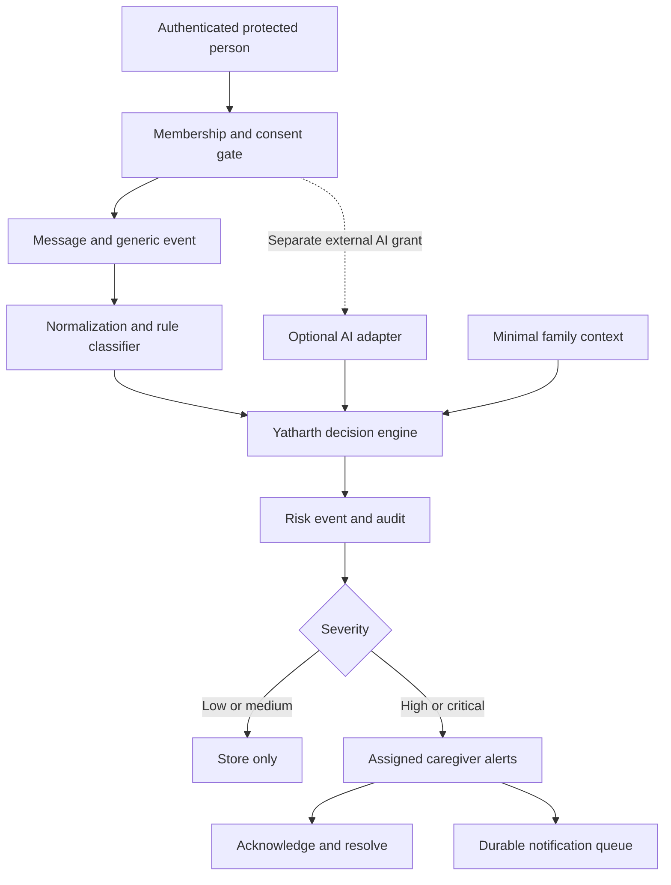

# Engineering handoff — Yatharth AI V0.1

## Delivery status

The independent consent → ingestion → event → deterministic risk → decision →
caregiver alert → acknowledgement → resolution path is implemented and executed.
OpenWorker core is unmodified. No upstream source is copied. Docker's exact startup
command remains an environment-blocked verification item, so the entire requested
Docker definition of done is not claimed complete.

## Architecture



FastAPI runs a modular monolith. SQLAlchemy owns transactions. PostgreSQL is the
Compose database; SQLite is a development fallback. The minimal frontend is static
HTML/CSS/JavaScript served from the backend, without a build pipeline. Swagger is
always available. Redis/Celery, autonomous tools and broad memory are unnecessary.

Yatharth owns all product decisions. Optional infrastructure returns evidence only.
No provider can grant consent, access the database, change permissions, or notify
caregivers. No raw context history or family identifiers are sent to providers.

## Repository tree

```text
yatharth/
  app/
    main.py                 app factory, errors, security headers, delivery worker
    models.py               SQLAlchemy entities
    schemas.py              strict input validation
    demo.py                 explicit synthetic HTTP demonstration
    retention.py            raw-content expiry command
    api/routes.py           auth, family, consent, ingestion, alerts, feedback, audit
    core/                   settings, database, password/JWT security
    services/
      risk.py               ontology, rules, interfaces, decision engine
      adapters.py           optional LLM/OpenWorker boundaries
      context.py            family/person scoped metadata
      notifications.py      durable in-app delivery and provider interface
    evaluation/
      run.py                metrics command
      cases.json            100 synthetic labeled messages
      demo-messages.json    25 examples
  frontend/                 five functional dashboard sections
  tests/                    automated security, workflow and scoring tests
  docs/                     schema, OpenAPI, run results, handoff
  research/                 OpenWorker assessment
  infrastructure/           Docker verification script
  Dockerfile
  docker-compose.yml
  requirements.lock
  pyproject.toml
  .env.example
  README.md
```

## OpenWorker selection

Inspected commit: `074ad3f7165cde3fcc2dcbfb8c5a2a0b20116b3f`.
Detailed paths and findings are in `research/openworker-assessment.md`.

| Component | Use in V1 | Reason |
|---|---|---|
| ProviderClient completion contract | Optional compatibility adapter | Bounded classification through replaceable machinery |
| ProviderRouter | Optional lazy client in child process | Provider selection belongs outside the domain |
| Agent TurnEngine, autonomous tools | Not reused | Too much authority for a risk classifier |
| MCP client/server connectors | Not reused | No automatic signal collection in V1 |
| Workspace/session/global memory | Not reused | These scopes do not enforce family privacy |
| Automation scheduler | Not reused | Current pipeline is synchronous; in-app delivery uses a small loop |
| Upstream audit/security domain | Reference only | Tool permissions do not substitute for family consent |
| Desktop GUI/Tauri and speech sidecar | Not reused | Product needs only a small demonstrator |

## Database schema

Every entity has a UUID-string primary key and UTC `created_at`. Exact types,
foreign keys, indexes and constraints are in `schema.sql`.

| Entity | Important fields and constraints |
|---|---|
| User | name, unique normalized email, phone, role, Argon2 password hash |
| Family | name, owner_id, hashed invitation secret |
| FamilyMember | family_id, user_id, relationship; unique family/person |
| Consent | family_id, protected_person_id, scope, status, external_ai_allowed, grant/revoke times; unique family/person/scope |
| Message | family_id, sender_id, nullable sensitive content, source, timestamp, request_id, content digest; unique sender/request |
| Event | family_id, person_id, type, source, timestamp, metadata-only payload referencing message/consent |
| RiskEvent | family_id, unique message_id, category, score, severity, confidence, signals, explanation, action, model version, decision trace |
| Alert | risk_event_id, caregiver_id, family_id, severity, title/summary, status, acknowledgement/resolution times, feedback label; unique risk/caregiver |
| AuditLog | actor, action, resource ID, family_id, timestamp; no content |
| Notification | unique alert_id, status, attempt count |

The analysis transaction persists message, generic event, risk, alerts, queue and
audit together. A database error rolls it all back. Notification failure happens
after that transaction and cannot erase an alert. Client request IDs prevent replay
duplicates; mismatched content/family/source with the same ID returns 409.
PostgreSQL serializes family membership/consent changes and analysis using row locks.
This intentionally favors correctness over per-family throughput. SQLite uses a
single-process lock and should not be run with multiple workers.

## Risk ontology and decisions

Ten requested scam categories plus NONE/UNKNOWN are implemented. Rules normalize
Unicode, whitespace and zero-width formatting. URL indicators are string checks;
the application never fetches links from submitted messages.

| Signal | Points |
|---|---:|
| Financial request | 30 |
| Credential request | 35 |
| Urgency | 15 |
| Impersonation | 20 |
| Account threat | 20 |
| Legal threat | 20 |
| Secrecy | 25 |
| Suspicious link | 20 |
| Authority claim | 15 |
| Emotional pressure | 10 |
| Unusual request | 30 |

Scores cap at 100. An isolated signal cannot reach the alert threshold. Investment
promises are not counted twice as independent payment evidence. An urgent financial
request combined with emotional pressure adds 10 combination points, recorded in
the decision trace. Known negative credential requests are excluded, but contextual
negation remains a prototype limitation.

Defaults: LOW 0–29; MEDIUM 30–59; HIGH 60–79; CRITICAL 80–100. High and critical both
create alerts immediately in the request transaction. Low/medium store risk privately.
Thresholds are configurable and validated. A high-risk message with no caregiver
returns `NO_CAREGIVER_CONFIGURED`, never a false claim of delivered protection.

AI can add up to 10 points only with confidence >=0.8 and at least two signals
corroborating existing rules; it cannot suppress strong rule evidence or invent an
alert from zero rule evidence. Its prose is not exposed to caregivers, preventing
raw-message leakage through generated summaries. Family context currently records
caregiver count and person-scoped prior risk count; history does not increase scores.
Confidence is an uncalibrated measure of rule-evidence strength, not probability.

## API contract

All routes start `/api/v1`. Except health, registration and login, bearer authentication
is required. The full OpenAPI document supplies request schemas and examples of
allowed fields. Validation rejects extra properties and does not echo private inputs.

| Method/path | Access and purpose |
|---|---|
| POST /users; POST /auth/login | Register/login; no role elevation beyond two roles |
| GET /users/{id} | Own account only |
| POST /families; GET /families | Create/list own families |
| GET /families/{id} | Members; minimal roster, no email/phone disclosure |
| POST /families/{id}/members | Join as self with invitation; owner can update own relationship |
| POST /consents | Protected person grants own permission |
| GET /consents?family_id= | Family permission status, protected person sees own grants |
| POST /consents/{id}/revoke | Protected person only |
| POST /messages/analyze | Protected person's own manually submitted signal; active consent |
| GET /messages/{id} | Original sender only, even for family caregivers |
| GET /risk-events/{id} | Original sender or assigned alert recipient |
| GET /alerts; GET /alerts/{id} | Assigned caregiver only; bounded pagination |
| POST /alerts/{id}/acknowledge | UNREAD → ACKNOWLEDGED; idempotent |
| POST /alerts/{id}/resolve | ACKNOWLEDGED → RESOLVED; idempotent |
| POST /alerts/{id}/feedback | Store label; no automatic training |
| GET /audit?family_id= | Own sensitive actions only, bounded limit |
| GET /health | Database connectivity and enabled-mode status |

403 indicates consent/access denial, 404 missing resource, 409 conflict/invalid
transition, 422 invalid input, 429 local rate limit, 503 unavailable database.
A caregiver sees a concise templated explanation, detected signals and recommendation.
There is no endpoint listing the parent's messages or all low-risk activity.

## Execution and validation results

- Python 3.12.14; exact installed application/test dependencies in `requirements.lock`.
- 46 tests passed against SQLite and against PostgreSQL 16.2, including duplicate
  requests in parallel, transaction rollback, consent, authorization, retention,
  scoring boundaries, provider fallback and alert transitions.
- Live HTTP demo: LOW 0/no alert; MEDIUM 30/no alert; CRITICAL 100/alert; caregiver
  acknowledged and resolved; revoked consent rejected further analysis; raw content
  access by caregiver denied. Both optional provider flags were false.
- Provider contract tests use fakes. No real provider credentials, billing or external
  messages were used. No automatic social, email, WhatsApp or phone access exists.
- One dependency deprecation warning: current Starlette TestClient warns about its
  httpx transport. This does not affect the passing tests; track a future migration.
- `docker compose up --build` could not run: Docker executable absent. Compose and
  container execution remain to be verified on a Docker-capable machine.

### Internal prototype evaluation

100 distinct hand-authored synthetic messages; labels were not generated from rule
scores. Rules were refined against discovered failures, so this is a regression set,
**not** an independent held-out benchmark or real-world validation.

Positive means labeled HIGH/CRITICAL and predicted to cause an automatic alert.
SAFE/LOW/MEDIUM are negative for this operational decision, not necessarily safe.

| Metric | Result |
|---|---:|
| True positives | 37 |
| False positives | 0 |
| True negatives | 60 |
| False negatives | 3 |
| Precision | 100% |
| Recall / HIGH-CRITICAL recall | 92.5% |
| F1 | 96.10% |
| Exact severity accuracy (SAFE mapped to LOW) | 94% |

Remaining dangerous misses: Y069 investment promise without explicit payment;
Y085 and Y100 Hinglish requests. Lower-risk severity disagreements also remain.
The complete unedited mismatch list is in `evaluation-results.txt`.
Zero false positives on 60 synthetic cases does not establish a low real-world
false-alarm rate. Language/obfuscation and unseen wording require further evaluation.

## Security and privacy threat model

| Threat | Implemented control | Remaining work |
|---|---|---|
| Caregiver surveillance / forged consent | Self-only grants, sender-bound input, raw data self-only, audience change invalidates grants | Independent identity verification, accessible consent review |
| Cross-family object access | Membership checks and assigned-recipient authorization, tests | External penetration testing, uniform anti-enumeration errors |
| Password compromise | Argon2 hashes, short-lived signed JWT, generic login failures | MFA, recovery, breached-password checks, token revocation |
| Prompt injection in messages | No tools, schema validation, rule-controlled action, no provider prose in alerts | Adversarial corpus and vendor review |
| Unsafe URL execution / SSRF | No message-link fetching, HTTPS configured provider endpoint, no redirects | Operator endpoint allowlist and network egress policy |
| Duplicate or partial events | Transactional writes, unique constraints, request IDs | Distributed load/concurrency testing |
| Consent race | Common family/person locks on ingestion and consent changes | Load tests and shorter lock duration for AI-enabled mode |
| Notification outage | Persist-first alerts plus retryable queue | Provider delivery receipts, dead-letter handling, monitoring |
| Database outage | Controlled errors, rollback, redacted SQL parameters | HA, backup/restore drills, alerting |
| PII in errors/logs | No message text in audit, templated summaries, no validation input echo | Production log review, structured telemetry without PII |
| Retention overcollection | Configurable raw-message purge command | Full account deletion, metadata TTLs, backup expiry |
| Brute force / oversized input | Per-process request limiter, body cap, text bounds | Shared gateway limits, abuse controls, real-client-IP trust policy |

Messages are stored in the database as plaintext; require encrypted storage, TLS,
restricted DB access and an operational secrets manager before real deployment.
Do not submit real sensitive family content to an unreviewed prototype. No application
message encryption/key rotation is implemented. JWT signing secrets must be shared
explicitly across workers; ephemeral keys are development-only.

Consent revocation stops future analysis but does not delete already-created alerts
or audit records. Existing caregivers retain their assigned historical summaries.
Raw content remains available to its original sender until retention expiry.
The family invitation is a bearer secret, stored hashed; invitation expiry/rotation,
member removal and recipient consent receipts are V1.1 work. A new caregiver cannot
read old alerts and triggers re-consent for future messages.

## Known limitations and technical debt

- Manual/simulator/API submissions only. No WhatsApp, SMS, phone, wearable or real-time
  monitoring; no accident detection or emergency dispatch.
- In-app alerts only: the caregiver must open/refresh the dashboard. No push/SMS/email
  guarantee. Critical means immediate database creation, not external human contact.
- English-first regex coverage is shallow; real scams can bypass it. Confidence is
  not calibrated. Several legitimate scenarios may resemble risk combinations.
- No clinical, legal, financial or emergency claims are supported by the prototype.
- Database creation uses SQLAlchemy `create_all`; versioned Alembic migrations are
  required before modifying schemas with real persisted deployments.
- OpenWorker remains a separately configured optional runtime, not a pinned default
  dependency. Actual vendor adapters and model accuracy remain unverified.
- The HTTP classifier has transport timeouts and capped output, but a robust total
  deadline/circuit-breaker across all vendors is future work.
- Queue retries are at-least-once; future external providers must deduplicate by alert
  ID. No external provider is implemented or contacted.
- Raw-content retention is an explicit command, not an automatically scheduled job.
- No production deployment, GitHub repository creation, or public publishing performed.

## Recommended V1.1

1. Collect consented, de-identified, independently labeled English/Hindi/Hinglish
   cases; freeze a held-out set; report confidence intervals and category recall.
2. Add invite expiry/rotation, member removal, explicit recipient visibility and
   versioned consent receipts; verified identity and account recovery.
3. Add Alembic migrations, encrypted persistence, managed secrets, backup lifecycle,
   end-to-end deletion, dependency/security review and operational monitoring.
4. Add caregiver false-negative reporting outside existing alerts; reviewed feedback
   export with no automatic retraining.
5. Add one explicitly authorized push channel with retries, receipts, idempotency and
   a notification delivery dashboard. Never equate persistence with human response.
6. Verify the Docker path in CI and add PostgreSQL concurrency and outage load tests.

## V2 extension architecture

Keep a modular monolith until load or independent ownership warrants separation.
Add typed signal adapters for consented CARE/PROTECT/DETECT events, a versioned risk
ontology, consent-scoped context repositories and a response-policy interface.
Each signal carries person/family, source, timestamp and authorization provenance.
Add richer memory only with retention and access scopes; never reuse workspace-global
agent memory as family memory. Consider a durable event/outbox worker when delivery
volume demands it. Human confirmation, escalation policy and partner contracts must
precede emergency-response claims. Device/wearable integrations and independent
validation are prerequisites for any future physical safety capability.

## Browser verification

The dashboard was exercised in Chrome with synthetic caregiver and protected-person
accounts: registration, family creation/join, explicit consent, HIGH-risk analysis,
alert retrieval, acknowledgement and resolution all worked. Switching accounts
cleared previous message input. A discovered sticky-banner overlap was fixed.
No JavaScript errors were reported by the browser error collector. See
`browser-verification.md`, `dashboard.png`, and `alert-resolved.png`.
